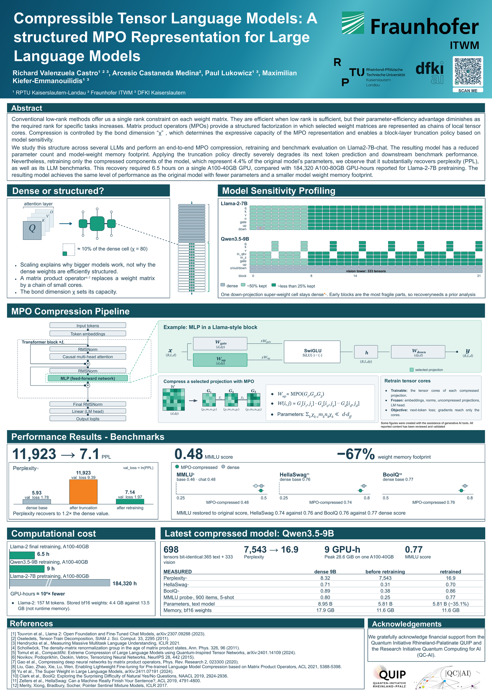

# 🧩 Compressible Tensor Language Models

### A structured MPO Representation for Large Language Models

 

 

### 📄 [Read the full poster (PDF)](poster/Compressible_Tensor_Language_Models_poster.pdf)

---

## 📌 TL;DR

Conventional low-rank methods offer us a single rank constraint on each weight matrix. They are efficient when low rank is sufficient, but their parameter-efficiency advantage diminishes as the required rank for specific tasks increases. Matrix product operators (MPOs) provide a structured factorization in which selected weight matrices are represented as chains of local tensor cores. Compression is controlled by the bond dimension χ, which determines the expressive capacity of the MPO representation and enables a block-layer truncation policy based on model sensitivity.

We study this structure across several LLMs and perform an end-to-end MPO compression, retraining and benchmark evaluation on Llama2-7B-chat. The resulting model has a reduced parameter count and model-weight memory footprint. Applying the truncation policy directly severely degrades its next token prediction and downstream benchmark performance. Nevertheless, retraining only the compressed components of the model, which represent 4.4% of the original model's parameters, we observe that it substantially recovers perplexity (PPL), as well as its LLM benchmarks. This recovery required 6.5 hours on a single A100-40GB GPU, compared with 184,320 A100-80GB GPU-hours reported for Llama-2-7B pretraining. The resulting model achieves the same level of performance as the original model with fewer parameters and a smaller model weight memory footprint.

---

## 🔬 Method

### Model sensitivity profiling

Early blocks are the most fragile part of both models, so recovery needs a prior sensitivity analysis. The compression maps keep roughly half of each cell in blocks 0–7 and less than a quarter in blocks 8–31.

| model | cells compressed | kept dense |
|---|---|---|
| Llama-2-7B | q, k, v, o, gate, up, down in all 32 blocks | one down-projection "super-weight" cell [9], embeddings, norms, LM head |
| Qwen3.5-9B | q, k, v (attention blocks), in_qkv, in_z (DeltaNet blocks), gate, up in all 32 blocks | o / out / down projections, embeddings, norms, LM head, the vision tower (333 tensors) |

---

## 📊 Results

### Llama-2-7B-chat

Perplexity uses `val_loss = ln(PPL)` [12]; MMLU [3], HellaSwag [11] and BoolQ [10] are the standard benchmarks.

| | dense base | after truncation | after retraining |
|---|---:|---:|---:|
| perplexity | 5.93 | 11,923 | 7.14 |
| val_loss | 1.78 | 9.39 | 1.97 |

| benchmark | dense | MPO-compressed, retrained |
|---|---:|---:|
| MMLU | 0.46 (base) · 0.48 (chat) | 0.48 |
| HellaSwag | 0.76 (base) | 0.74 |
| BoolQ | 0.77 (base) | 0.76 |

Weight memory footprint **−67%**: stored bf16 weights go from 13.5 GB to 4.4 GB (6.74 B → 2.22 B parameters, from parameter counts). This is stored weight size, not runtime memory.

### Qwen3.5-9B (latest compressed model)

Qwen3.5-9B is a hybrid DeltaNet + attention multimodal model. Only the text model is compressed; the vision tower and every other untouched tensor are bit-identical after export (698 tensors: 365 text + 333 vision).

| | dense 9B | before retraining | retrained |
|---|---:|---:|---:|
| perplexity [12] | 8.32 | 7,543 | 16.9 |
| HellaSwag [11] | 0.71 | 0.31 | 0.70 |
| BoolQ [10] | 0.89 | 0.38 | 0.86 |
| MMLU probe [3] (900 items, 5-shot) | 0.80 | 0.25 | 0.77 |
| parameters, text model | 8.95 B | 5.81 B | 5.81 B (−35.1%) |
| memory, bf16 weights | 17.9 GB | 11.6 GB | 11.6 GB |

Retraining ran on one A100-40GB with a peak of 28.6 GiB.

### Computational cost

| run | GPU | hours |
|---|---|---:|
| Llama-2-7B-chat final retraining | A100-40GB | 6.5 h |
| Qwen3.5-9B retraining | A100-40GB | 9 h |
| Llama-2-7B pretraining (reported in [1]) | A100-80GB | 184,320 h |

About 10⁴× fewer GPU-hours than pretraining; the Llama-2 retraining saw 157 M tokens. The retraining starts from a pretrained model, so the comparison shows scale, not a substitute for pretraining.

---

## 🚧 Coming soon

The detailed methodology will be published here shortly:

* the block-layer truncation policies and the sensitivity profiling behind them,
* the MPO compression code (TT-SVD factorisation, per-cell χ selection),
* the core-only retraining recipe and the evaluation scripts,
* a write-up with the full experimental protocol.

Watch or star the repository to be notified.

---

## 📚 References

1. Touvron et al., Llama 2: Open Foundation and Fine-Tuned Chat Models, arXiv:2307.09288 (2023).
2. Oseledets, Tensor-Train Decomposition, SIAM J. Sci. Comput. 33, 2295 (2011).
3. Hendrycks et al., Measuring Massive Multitask Language Understanding, ICLR 2021.
4. Schollwöck, The density-matrix renormalization group in the age of matrix product states, Ann. Phys. 326, 96 (2011).
5. Tomut et al., CompactifAI: Extreme Compression of Large Language Models using Quantum-Inspired Tensor Networks, arXiv:2401.14109 (2024).
6. Novikov, Podoprikhin, Osokin, Vetrov, Tensorizing Neural Networks, NeurIPS 28, 442 (2015).
7. Gao et al., Compressing deep neural networks by matrix product operators, Phys. Rev. Research 2, 023300 (2020).
8. Liu, Gao, Zhao, Xie, Lu, Wen, Enabling Lightweight Fine-tuning for Pre-trained Language Model Compression based on Matrix Product Operators, ACL 2021, 5388–5398.
9. Yu et al., The Super Weight in Large Language Models, arXiv:2411.07191 (2024).
10. Clark et al., BoolQ: Exploring the Surprising Difficulty of Natural Yes/No Questions, NAACL 2019, 2924–2936.
11. Zellers et al., HellaSwag: Can a Machine Really Finish Your Sentence?, ACL 2019, 4791–4800.
12. Merity, Xiong, Bradbury, Socher, Pointer Sentinel Mixture Models, ICLR 2017.

